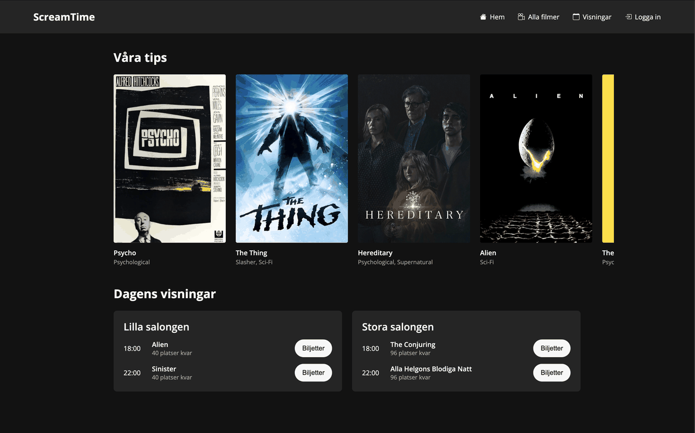
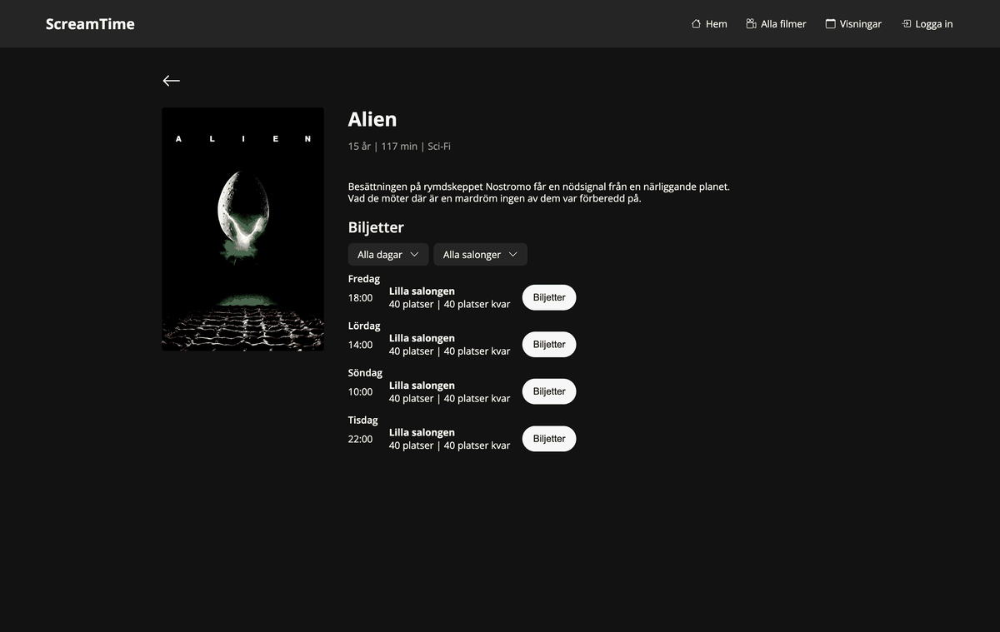
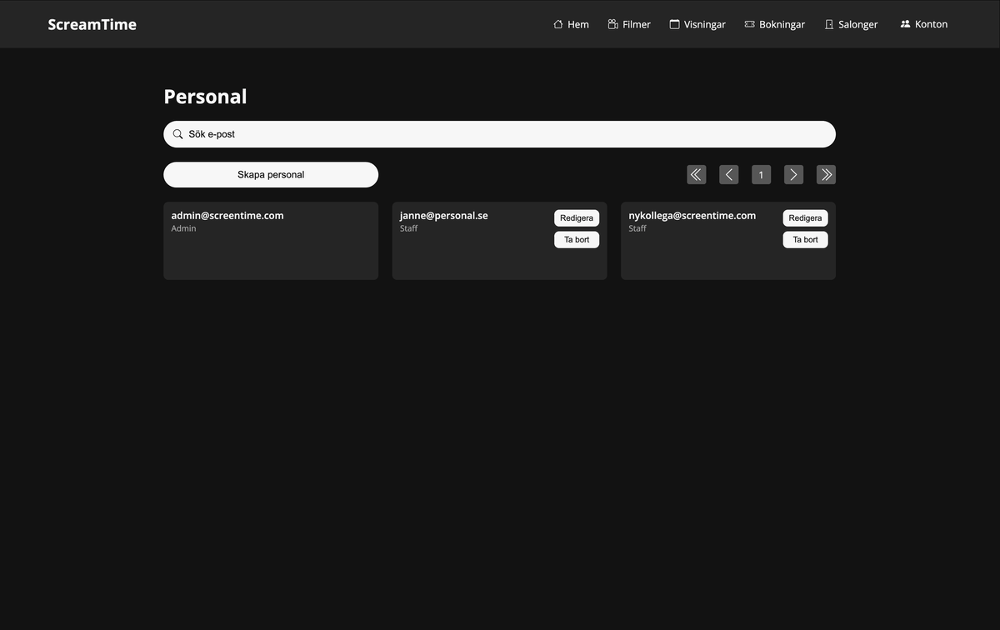
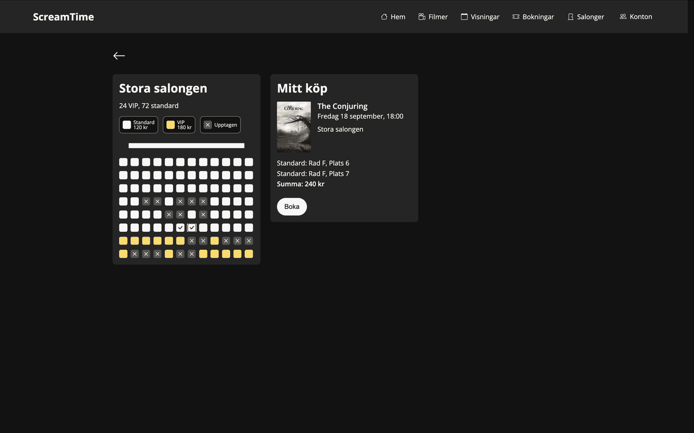
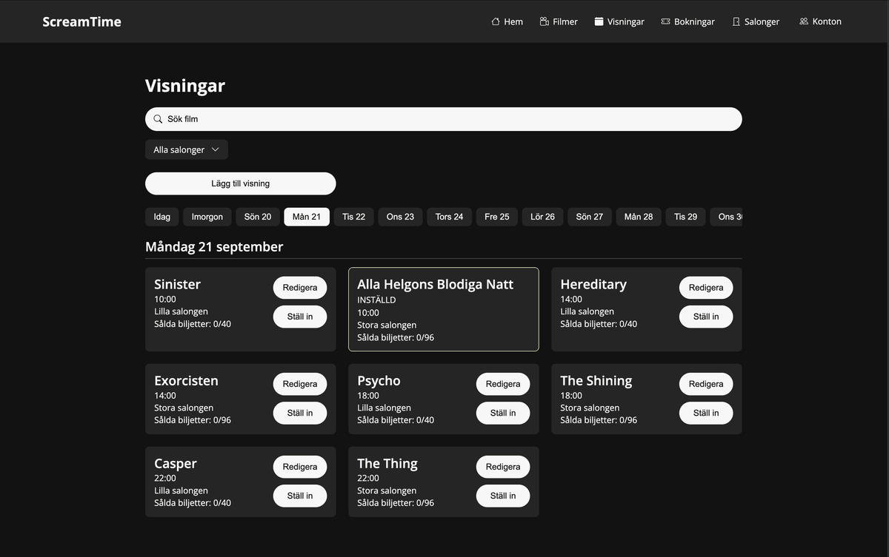
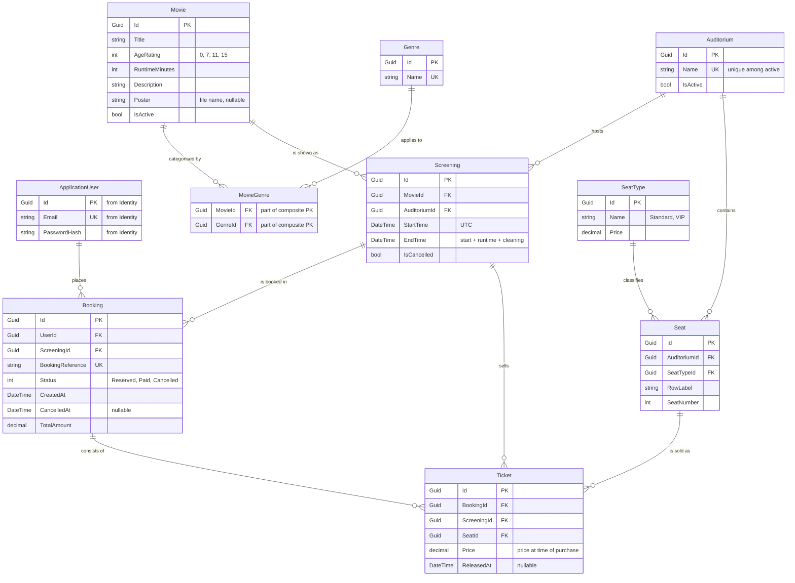

# ScreamTime – Cinema and Booking System

ScreamTime is a full-stack application for administering and booking cinema screenings. It covers movies, auditoriums, screenings, seat selection, bookings, user accounts and role-based authorisation.

The project was built as a group assignment in systems development, and consists of a REST API in ASP.NET Core and a React frontend.

Supporting documentation – requirements, test strategy and agile process – lives in the [project wiki](https://github.com/Filipmonteza/ScreamTime/wiki).

The user interface is in Swedish. Page and section names are quoted in Swedish throughout this document so they match what you see on screen.



## Getting started

### Prerequisites

- [.NET 8 SDK](https://dotnet.microsoft.com/download/dotnet/8.0)
- [Node.js](https://nodejs.org/) version 24 (see `frontend/.nvmrc`)
- npm
- Git

Check your installation with:

```bash
dotnet --version
node --version
npm --version
```

### Install

```bash
git clone https://github.com/Filipmonteza/ScreamTime.git
cd ScreamTime
dotnet restore
cd frontend && npm install && cd ..
```

### Run

The backend and frontend run at the same time in two terminals. The commands work in both PowerShell and bash.

Terminal 1 – backend, from the repository root:

```bash
dotnet run --project backend/src/ScreenTime.WebApi/ScreenTime.WebApi.csproj --launch-profile http
```

Terminal 2 – frontend:

```bash
cd frontend
npm run dev
```

| | Address |
|---|---|
| Frontend | <http://localhost:5173> |
| API | <http://localhost:5267> |
| Swagger | <http://localhost:5267/swagger> |

The database is committed to the repository, and in development the backend migrates and seeds it on startup if it is missing, so a fresh clone needs nothing beyond the commands above. The frontend calls the backend on port `5267`, and the backend allows CORS from `http://localhost:5173`. Change one and you have to change the other.

### Sign in

These accounts are seeded automatically and are meant for local development and demonstration.

| Role | Email | Password |
|---|---|---|
| Customer | `test@screentime.com` | `Test1234!` |
| Admin | `admin@screentime.com` | `Admin1234!` |

No staff account is seeded – sign in as the administrator and create one under **Personal** to try the `Staff` role.

## Features

### Visitors and customers

- Browse available movies and movie details.
- Search and filter movies by title, genre, day and auditorium.
- See upcoming screenings.
- Register an account and sign in.
- Pick seats for a screening from a seat map showing what is already taken.
- See prices for standard and VIP seats.
- Place a booking and receive a confirmation with a booking reference.
- View current bookings and booking history.
- Cancel a booking up to 15 minutes before the screening starts.
- Change the email address and password on their own account.
- Close their own account, which only an administrator can reactivate.



*A movie's detail page: age rating, runtime, genre and every upcoming screening, filterable by day and auditorium.*

### Staff and administrators

- Create, edit and deactivate movies.
- Create and administer auditoriums.
- Configure an auditorium's seats and seat types.
- Create, edit and cancel screenings.
- See cancelled and past screenings as well.
- Prevent overlapping screenings in the same auditorium.
- Search all bookings by booking reference or email address.

### Administrators only

- Create staff accounts and assign roles.
- Change the email address and password of existing staff accounts.
- Deactivate and reactivate accounts, though never their own.

## Roles and permissions

| Capability | Customer | Staff | Admin |
|---|:---:|:---:|:---:|
| View movies and screenings | Yes | Yes | Yes |
| Place bookings | Yes | Yes | Yes |
| View and cancel own bookings | Yes | Yes | Yes |
| Manage own account | Yes | Yes | Yes |
| Administer movies | No | Yes | Yes |
| Administer auditoriums and seats | No | Yes | Yes |
| Administer screenings | No | Yes | Yes |
| Search all bookings | No | Yes | Yes |
| Create staff accounts and assign roles | No | No | Yes |

Permissions are enforced in both the frontend and the backend. The frontend hides what a role cannot reach, and the backend protects every administrative endpoint with `[Authorize]` and a role requirement.



*The **Personal** page, which only administrators can reach: create accounts, assign the `Staff` role, edit and deactivate.*

## Where things live

| Area | Backend | Frontend |
|---|---|---|
| Movies and genres | `MoviesController`, `GenresController`, `MovieService` | **Alla filmer**, the movie detail page, **Filmer** (staff) |
| Auditoriums and seats | `AuditoriumsController`, `SeatsController`, `AuditoriumService` | **Salonger** (staff) |
| Screenings | `ScreeningsController`, `ScreeningService` | **Visningar**, **Hem** |
| Bookings | `BookingsController`, `BookingService` | the seat-selection page, **Mina Bokningar**, **Bokningar** (staff) |
| Accounts and roles | `AuthController`, `AccountController`, `AdminController` | sign-in and registration, **Mitt konto**, **Personal** (admin) |

Repositories sit behind the services in `ScreenTime.Infrastructure/Repositories`, all on the generic `Repository<TEntity>` base described under [Technical concepts](#technical-concepts).

## User scenarios

### Scenario 1 – A customer books cinema tickets

**As a customer I want to pick a screening and free seats so that I can book cinema tickets.**

1. The customer opens a movie and picks an upcoming screening.
2. The system shows the auditorium's seats and their availability.
3. The customer selects standard or VIP seats.
4. The system shows the total price.
5. The customer confirms the booking and receives a booking reference.
6. The booking appears under the customer's current bookings.
7. The booked seats are marked unavailable to other customers.

If somebody else takes the same seat in the meantime, the booking is aborted and the customer is told which seats are no longer free. Double booking is impossible even if two customers click at the same instant: the database holds a unique index on `(ScreeningId, SeatId)` that counts only active tickets.



*Steps 2–5: standard and VIP seats priced separately, taken seats blocked, and the running total on the right.*

### Scenario 2 – A customer cancels a booking

**As a customer I want to cancel a future booking so that the seats become available again.**

1. The customer signs in and opens their bookings.
2. The customer picks a booking that can still be cancelled.
3. The system checks that more than 15 minutes remain until the screening.
4. The booking's status changes to cancelled.
5. The booking moves to the booking history.
6. The reserved seats become available to other customers.

Later than 15 minutes before the start, the cancellation is refused and the booking stands.

### Scenario 3 – Staff administer a screening

**As a member of staff I want to create and administer screenings so that the programme stays up to date.**

1. The staff member signs in with the `Staff` or `Admin` role.
2. They pick a movie, an auditorium and a start date and time.
3. The system derives the end time from the movie's runtime plus cleaning time.
4. The system checks that the screening does not overlap another one in the same auditorium.
5. A valid screening is added to the programme.
6. The staff member can later edit or cancel it.

Cancelling a screening also cancels the bookings sold for it, and frees the slot in the auditorium for a new screening.



*The programme as staff see it, filtered by day and auditorium. A cancelled screening stays visible to staff, marked `INSTÄLLD`.*

## Architecture and data model

The backend is split into layers:

```text
backend/
├── src/
│   ├── ScreenTime.Domain/
│   │   ├── Entities/
│   │   ├── Enums/
│   │   └── Common/
│   ├── ScreenTime.Application/
│   │   ├── Contracts/
│   │   ├── Interfaces/
│   │   ├── Services/
│   │   └── Exceptions/
│   ├── ScreenTime.Infrastructure/
│   │   ├── Authentication/
│   │   ├── Data/
│   │   ├── Identity/
│   │   ├── Migrations/
│   │   └── Repositories/
│   └── ScreenTime.WebApi/
│       ├── Controllers/
│       ├── Filters/
│       └── Program.cs
└── tests/
    └── ScreenTime.WebApi.IntegrationTests/
```

The frontend is split by responsibility:

```text
frontend/src/
├── api/
├── assets/
├── components/
├── context/
├── hooks/
├── pages/
├── types/
└── utils/
```

- **Domain** holds entities, enums and the core domain model.
- **Application** holds DTOs, interfaces and business logic.
- **Infrastructure** handles the database, repositories, Identity and JWT.
- **WebApi** exposes the functionality as REST endpoints.
- **Frontend** presents the system and talks to the backend over HTTP.

Dependencies point inwards: `WebApi` knows about `Application` and `Infrastructure`, both of which know about `Domain`. `Domain` knows about nothing else.

> The product is called ScreamTime. The projects and namespaces in the code have been called `ScreenTime.*` since the solution was created and have been left that way.

### Data model

The Identity tables (`AspNetRoles`, `AspNetUserRoles` and the rest) are generated by the framework and left out here.



A few choices worth knowing before writing against the model:

- **Seats belong to the auditorium, not to the screening.** A `Seat` exists whether or not anything is playing. What is free for a screening is derived: the auditorium's seats minus the seats holding an active ticket for that screening.
- **Price lives on `SeatType`, not on the seat.** Changing the VIP price is one update instead of hundreds.
- **`Ticket` stores the price that applied at purchase.** Later price changes do not rewrite old receipts.
- **Cancelling releases tickets instead of deleting them.** `Ticket.ReleasedAt` is set, the row survives as history, and the filtered unique index on `(ScreeningId, SeatId)` – which applies only where `ReleasedAt` is `NULL` – frees the seat again. That index is also what makes double booking impossible, independently of the checks in the code.
- **`Booking.UserId` is a plain `Guid` with no navigation property.** The user lives in Identity, which sits in Infrastructure, and `Domain` is not allowed to know about that layer.
- **`(AuditoriumId, RowLabel, SeatNumber)` is unique.** No duplicate chairs.

## Technical concepts

Three things shape most of the backend code: a generic repository, LINQ over EF Core, and asynchronous access all the way down.

### Generics

A generic repository abstraction covers the operations every entity shares:

```csharp
public interface IRepository<TEntity> where TEntity : BaseEntity
```

```csharp
public abstract class Repository<TEntity> : IRepository<TEntity>
    where TEntity : BaseEntity
```

`TEntity` lets one implementation serve movies, auditoriums, bookings and screenings alike. The `where TEntity : BaseEntity` constraint guarantees the entity has an `Id`, and that is what makes `GetByIdAsync` expressible generically:

```csharp
public virtual async Task<TEntity?> GetByIdAsync(
    Guid id,
    bool track = false,
    CancellationToken cancellationToken = default) =>
    await Query(track)
        .FirstOrDefaultAsync(entity => entity.Id == id, cancellationToken);
```

Source: `backend/src/ScreenTime.Infrastructure/Repositories/Repository.cs`

### LINQ and asynchronous access

Every read is a LINQ query against EF Core, and every one of them is awaited – no server thread blocks on the database. A `CancellationToken` is threaded from the controller down to the query, so an abandoned HTTP request cancels the work it started.

One query stands in for the pattern. The seat count per auditorium resolves in a single round trip instead of one per auditorium:

```csharp
await Context.Seats
    .Where(s => auditoriumIds.Contains(s.AuditoriumId))
    .GroupBy(s => s.AuditoriumId)
    .Select(g => new
    {
        AuditoriumId = g.Key,
        Count = g.Count()
    })
    .ToDictionaryAsync(
        x => x.AuditoriumId,
        x => x.Count,
        cancellationToken);
```

Source: `backend/src/ScreenTime.Infrastructure/Repositories/AuditoriumRepository.cs`

## Testing

The backend has 51 integration tests that run against a real API through `WebApplicationFactory`, each test class against its own SQLite database. SQLite rather than the EF in-memory provider because the in-memory provider ignores unique indexes, so a broken double-booking constraint would pass its own test unnoticed.

The tests are written scenario-first: each name states the situation and the expected outcome, for example `Create_RunningIntoTheStartOfAnExistingScreening_IsRejected`.

| Test file | Tests | Covers |
|---|---|---|
| `ScreeningTests.cs` | 26 | Creating, editing and cancelling screenings, every overlap case within one auditorium, time zone handling, filtering by auditorium, date and genre, and cancellation together with its effect on existing bookings. |
| `AuditoriumTests.cs` | 10 | Creating, renaming and closing a salong with valid and invalid data, the soft delete that takes a salong off the public list without losing its seats, and closing refused while the salong still has screenings to come – allowed once they are cancelled or already playing. |
| `BookingTests.cs` | 4 | Booking the seats a customer picked and the confirmation they get back, double-booking refused through the API and at the database index, and a seat released by a cancellation becoming bookable again. |
| `AccountDeactivationTests.cs` | 4 | A customer closing their own account, the token they already hold being refused on the next request, an administrator reactivating the account so that the same token works again, and an administrator refused when closing their own. |
| `RegisterTests.cs` | 2 | Registering with a new email, and a registration refused because the password confirmation does not match. |
| `AuthFlowTests.cs` | 1 | Registration, sign-in, access to protected endpoints and sign-out. |
| `RoleAuthorizationTests.cs` | 1 | A customer being denied access to administrative endpoints. |
| `StaffAccountFlowTests.cs` | 1 | An administrator creating a staff account, and that account signing in with the `Staff` role. |
| `MovieTests.cs` | 1 | A film being removed from the catalogue, and staying gone for staff as well as customers. |
| `SeatTests.cs` | 1 | Adding seats of both types to a salong, and the capacity counted from them. |

### Where coverage could be extended

- **Service rules** — several are only exercised in passing by a larger scenario and could each have a test of their own.
- **Permissions** — covered per role, not per endpoint.
- **Frontend** — no JavaScript test runner, so client-side state is untested.
- **Concurrency** — two bookings on one seat is simulated by writing the second ticket directly, not fired in parallel.
- **Seat removal** — untested because there is no endpoint for it yet.

```bash
dotnet test ScreenTime.sln     # backend tests
cd frontend && npm run build   # production build, also type-checks the project
cd frontend && npm run lint    # ESLint
```

All of the above runs in CI: GitHub Actions builds both halves, runs the backend tests and runs ESLint on every pull request against `main` and `dev`, and on pushes to `main` (`.github/workflows/ci.yml`).

## API documentation

With the backend running in development, the interactive API documentation is at <http://localhost:5267/swagger>.

For endpoints that require authentication:

1. Sign in through `/api/auth/login`.
2. Copy the JWT from the response.
3. Click **Authorize** in Swagger.
4. Paste the token.
5. Call the protected endpoint.

## Database and seed data

The project uses SQLite, and the database file at `backend/src/ScreenTime.WebApi/screenTime.db` is committed to the repository, so a fresh clone has a populated database without running anything first.

In development the backend does the following on startup: creates the database if it is missing, applies pending EF Core migrations, inserts seed data, creates the roles, and creates the development accounts. Seeding is skipped when the database already holds data, so the committed file is left as it is. To start over, delete it and run the backend again.

The seed data contains:

- 10 movies with age rating, runtime, description and poster.
- 4 genres: Supernatural, Psychological, Slasher and Sci-Fi.
- 2 auditoriums: Stora salongen (96 seats, rows G and H are VIP) and Lilla salongen (40 seats, all standard).
- The seat types Standard (120 kr) and VIP (180 kr).
- Four weeks of programme counted from the day the database is seeded: four screenings per day and auditorium (10:00, 14:00, 18:00 and 22:00), each with 20 minutes of cleaning time after the film. The committed file was seeded on 2026-09-22 and so runs to 2026-10-19; regenerate it as described above for a later window.
- The `Admin`, `Staff` and `Customer` roles, plus two test accounts.

The roles are seeded in every environment because registration assumes the `Customer` role already exists.

## Change request

A change request came out of a demo for the client, about the layout of the home page. At the time the home page had two sections: **Våra tips** and **Hitta film**, the latter holding the whole movie catalogue with search and filtering. The two sat too close together – both were grids of posters – and between them they said the same thing twice.

The change went through the normal process: raised as a task, built on the `L-restructure-homepage` branch, and reviewed and merged in [pull request #300](https://github.com/Filipmonteza/ScreamTime/pull/300).

The outcome:

- **Hitta film** was replaced on the home page by **Dagens visningar**, grouped by auditorium (the layout shown at the top of this page). It answers a different question from **Våra tips** – what is on today, rather than what we recommend – and the two can no longer be confused.
- The movie catalogue with search and filtering was kept, but on a page of its own, **Alla filmer**, reachable from the menu.
- The seed data was reworked into four screenings per day and auditorium, so the home page has a programme to show straight after a fresh database is created.

## Team

The project was built as a group assignment using agile methods, feature branches, pull requests and shared code review.

| Name | Areas of responsibility | Role |
|---|---|---|
| Amanda | Backend, Frontend | Requirements Manager, Software Engineer |
| Björn | Frontend, Design | Scrum Master, Software Engineer |
| Ezana | Backend, Authentication, Infrastructure | Security Consultant, Software Engineer |
| Filip | Backend, Testing, Domain, API | Test Lead, Software Engineer |
| Luca | Backend, Frontend, Database | Tech Lead, Software Engineer |

## License

Built for educational purposes and not intended for commercial use.
